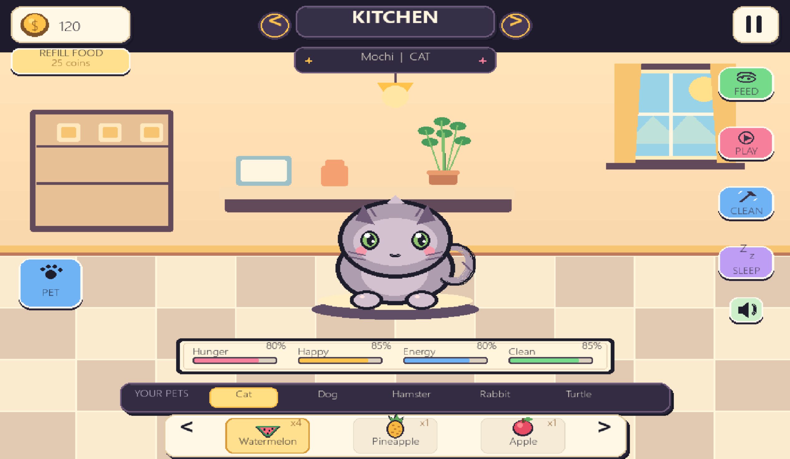
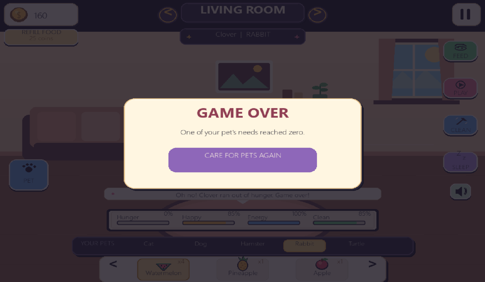

# Pixel Pals 🐾

Pixel Pals is a cozy virtual pet game built with Python and Pygame. Adopt your favorite companion, explore different rooms, feed your pets, and keep them happy, healthy, and well cared for.

## Features

- **Five pets:** Cat, Dog, Hamster, Rabbit, and Turtle, each with its own appearance and sound.
- **Six rooms:** Kitchen, Bedroom, Living Room, Bathroom, Garden, and Attic.
- **Food and inventory:** 12 different food and drink items, an inventory system, and the ability to restock using coins.
- **Pet care:** Feed, play with, clean, put to sleep, and pet your companions.
- **Pet stats:** Monitor hunger, happiness, energy, and cleanliness.
- **Coin system:** Earn coins through care activities and spend them on restocking food.
- **Sound effects:** Synthesized sound effects, individual animal sounds, and a mute toggle.
- **Automatic saving:** Your progress is saved locally between sessions.
- **Pause and fullscreen:** Pause the game or switch to fullscreen mode.
- **Custom visuals:** Pixel-inspired graphics, custom-drawn pets, icons, animations, and an interactive interface.

## Controls 🎮

| Control | Action |
|---|---|
| `Mouse click` | Interact with buttons, pets, rooms, and food |
| `1`–`5` | Select a pet |
| `Q` | Previous room |
| `E` | Next room |
| `Left Arrow` / `Right Arrow` | Browse food inventory pages |
| `Space` | Pet the active companion |
| `Esc` | Pause or resume |
| `F11` | Toggle fullscreen |

## How to Play

1. Choose a pet to care for.
2. Monitor each pet's hunger, happiness, energy, and cleanliness.
3. Use the care buttons to keep your companions healthy.
4. Select an available food item before feeding a pet.
5. Earn coins through care activities and use them to restock food.
6. Explore different rooms and switch between your pets.

**Game Over:** The game ends if any pet's hunger, happiness, energy, or cleanliness reaches zero. Starting a new run resets your progress for that run.

## Built With

- Python
- Pygame
- JSON for local save data

## Getting Started

### Installation

Clone the repository and install Pygame:

```bash
git clone https://github.com/qopci/pixel-pals.git
cd pixel-pals
python -m pip install pygame
python main.py
```

### Save Data

The game automatically generates a `pet_save.json` file when saving your progress. This file stores your game data locally so your progress can be loaded when you play again.

The file is generated automatically and does not need to be created manually.

## Project Structure

```text
pixel-pals/
├── main.py          # Main game and gameplay logic
├── pet_save.json    # Generated automatically when saving progress
└── README.md        # Project documentation
```

The game includes built-in drawing and synthesized sound effects, so it can run without optional image assets.

## About the Project

*Pixel Pals* is a personal project created to practice Python programming, game development, UI design, event handling, animation, and saving game progress.

## Gameplay Preview 📸



